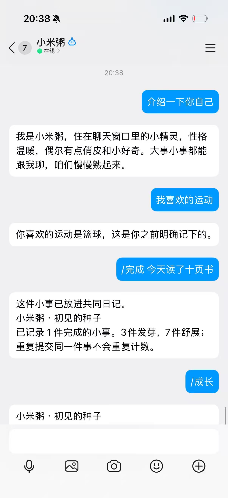

# 我把一个AI小精灵接进QQ：让它记住我，也允许我让它忘记

你有没有遇到过这种情况：和AI聊了一晚上，第二天换个窗口，它又像第一次认识你？我想做一个能在日常聊天软件里相处的角色，于是做了“小米粥”。它住在QQ单聊里，有固定性格，可以保存经过我确认的记忆，也会随着共同完成的小事改变成长阶段。

这次我没有先做复杂的界面，而是把重点放在一条完整流程：QQ发消息，机器人收到消息，模型生成回复，再回到同一个聊天窗口。能在手机上打开QQ试用，让作品从终端里的代码变成可以触达的角色。

## 第一步：先让角色在本地说话

项目使用Python，终端和QQ共用同一个角色内核。解压项目，在目录中安装requirements.txt，然后运行python start.py，选择本地模式。按照向导输入真实模型地址、模型ID和API Key，就能开始聊天。没有模型账号也能跳过配置，先测试记忆、删除和成长指令。

一开始，小米粥说话有些用力：每句话都想打个植物比喻，自我介绍也像功能说明。我根据真实试聊修改提示词，让它优先回应用户当下的话，简单问题简短回答，不固定反问，也不主动从随口提到的事情追问私人细节。角色感来自表达习惯，而不是每句话都重复设定。

## 第二步：把“记得”拆成可以检查的机制

近期上下文和长期记忆不同。当前版本会保留最近12条消息，所以刚告诉它中午吃了米饭，它可以在后续追问中回答。但这不意味着它已经永久记住这顿饭。

需要长期保存时，可以输入“/记住 喜欢的运动=篮球”。输入“/记忆”，能查看条目和原话依据；同名条目可以更新。普通对话还会由模型提出记忆建议，展示要保存什么、依据哪句话，用户发送“/确认记忆”后才写入。模型提取不一定准确，所以确认步骤是体验的一部分。

临时安排和稳定偏好也分开处理：临时记忆最多保留7天，到期停止使用。目前用固定期限，不宣称已经准确理解所有自然语言日期。聊天时采用中文片段匹配检索相关记忆，避免每轮都发送全部条目；这种方法轻量，但语义相近、用词不同的情况仍可能漏检。

## 第三步：验证它是否真的会忘记

我给演示设计了一条可以复现的路径：保存篮球偏好，发送“/新对话”，再问喜欢什么运动。新对话清除近期上下文，却保留长期记忆，因此可以检查回答有没有从长期存储里获取依据。

接着发送“/忘记 喜欢的运动”，再问同一个问题。删除时同时清理近期对话，避免旧聊天里出现的篮球继续进入模型。需要说明的是，这只管理本机数据库，不能替用户删除模型服务商的记录或已有备份。

## 第四步：接进QQ，做成能体验的作品

在QQ开放平台创建机器人，设置自己的开发体验账号，并按平台入口添加机器人。启动程序选择QQ模式，填入模型配置及QQ的AppID、AppSecret。看到“QQ连接已建立”后，在手机发送“/帮助”，收到指令列表就能确认收发链路。

开发过程中也遇到了真实问题：SDK要求完整的连接回调，还需要显式初始化HTTP客户端；新增记忆机制后，过于严格的JSON解析又让普通聊天报错。我补齐初始化和关闭流程，允许普通文本回复正常展示，而无效的记忆结构不落库，并添加了对应回归测试。自动化测试使用模拟网络，不能代替真实平台验证。

## 让成长有依据，也承认现在的边界

发送“/完成 今天读了十页书”，就能把小事放进共同日记。三件事发芽，七件事成为小树，相同文本不会重复计数。这是可解释的角色状态，不代表模型训练，也不会验证用户是否真的完成了事情。

目前QQ收发已跑通，语音、云端全天在线和角色立绘尚未实现。电脑关机后程序会停止。比起一次堆满功能，我更希望先把记住、更新、忘记和错误反馈做得清楚：陪伴角色除了会说话，还应该让人知道它依据什么回答，以及什么时候其实并不知道。

## 配图位置（提交前补充真实成功截图）

1. QQ成功问候与自然自我介绍。
2. 自动提出记忆建议及用户确认。
3. 新对话后正确找回篮球偏好。
4. 删除后不再知道该偏好。
5. 共同日记及成长阶段。

这些位置是待补素材，不是已经完成的实测证明。发布图文前应插入真实截图并去除QQ号、密钥等不必要信息。

## QQ实际效果

用户提供的真实截图展示了角色自我介绍、回答篮球偏好，以及记录一件完成的小事。截图未展示记忆写入与清除近期上下文的过程，因此不单独作为跨会话记忆或删除成功的证明。
